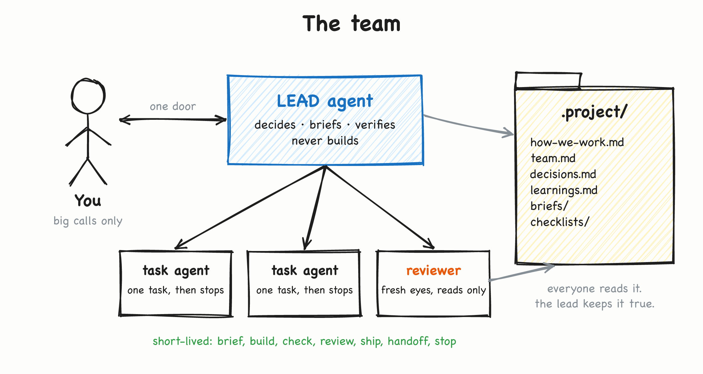
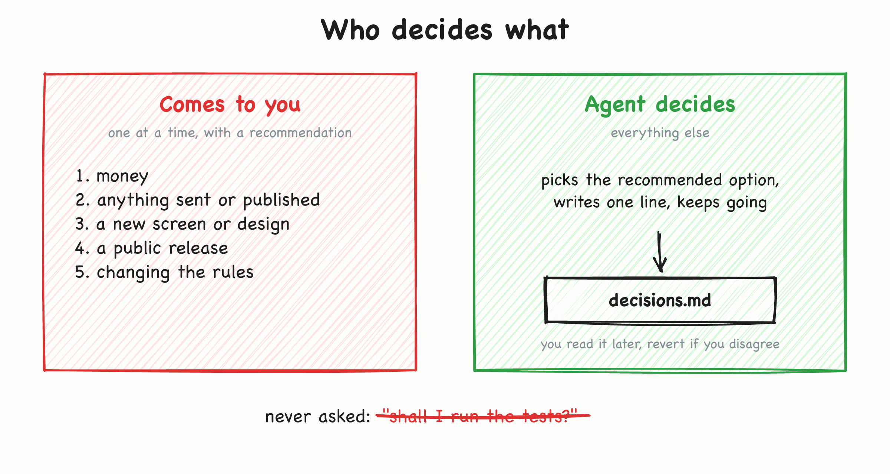
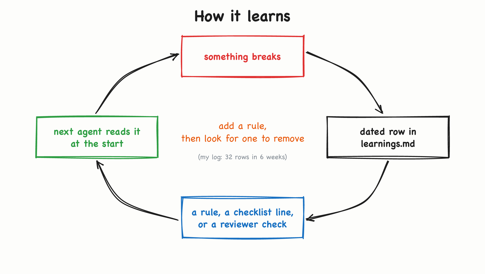

# Minimal agent team

A few markdown files that run my AI coding agents. No hooks, no scripts, no framework. You copy one folder into your repo, and your agents follow it.



## Why I made this

I spent about a year trying to build an autonomous AI company. I tried many agent stacks: skill packs, big AGENTS.md files, enforcing hooks, multi-agent frameworks. Every one of them failed in its own way. Most weeks I hit usage limits on the setup, not on the product.

What finally worked was the smallest setup I tried. Most of the gain came from removing things.

A few of the failures, from my own log:

1. 5 to 7 test runs in parallel pushed my Mac's load to about 290. Pre-push took 7 to 14 minutes, and tests flaked.
2. A small change re-ran a 45-minute e2e suite three times.
3. One small change got a 393-line safety check and 3 review rounds.
4. Builders sat idle for about 45 minutes between steps.
5. A process-only change took about 9 hours through the full ship pipeline.

Each of these is now one line in `learnings.md`, with the rule it created.

## How it works

1. **One lead agent, and it never builds.** It talks to you, briefs the other agents, checks their claims and keeps the log. When my lead built things itself, my questions waited behind its push loop.
2. **One fresh agent per task.** It does one task end to end, writes a handoff and stops. Long-lived agents drifted. They said "done" when it wasn't, and they lost decisions after context compaction.
3. **One independent reviewer per change.** It has no shared context with the builder. It only reads. At most 2 rounds.
4. **One heavy job at a time** on your machine (builds, full test suites, e2e). This saved more quota than any skill did.

## Who decides what



Only 5 kinds of calls come to you, one at a time, each with a recommendation. The agent decides everything else, writes one line in `decisions.md`, and keeps going. You read the log later and revert what you don't like.

This one rule removed most of the "shall I run the tests?" questions.

## How it learns



1. Something breaks.
2. The lead adds a dated row to `learnings.md`: what happened, and the rule it created.
3. The rule goes into `how-we-work.md`, a checklist, or the reviewer brief. Each bug that gets past a review adds one check for the reviewer.
4. The next agent reads it at the start.

When you add a rule, look for one to remove. Otherwise the rulebook grows until no agent follows it.

## What's in the folder

Everything is in [`template/`](template/):

1. **how-we-work.md:** the agreement itself. Roles, decisions, reporting, what "done" means, review, git, machine etiquette, outbound and secrets, upkeep, scheduled jobs, checklists.
2. **team.md:** agent names and per-repo settings (max live agents, work hours, heavy jobs, models).
3. **briefs/task-agent.md:** added to the start of every task agent's prompt.
4. **briefs/lead.md:** what the lead reads when it starts or restarts.
5. **briefs/reviewer.md:** added to every review request. It grows by one check per missed bug.
6. **learnings.md:** the incident → rule log, with my 32 rows to start from.
7. **decisions.md:** the one-line decision log.
8. **schedule.md:** every scheduled job. The lead starts the ones that are due.
9. **checklists/:** a PR checklist and a pre-review self-check.

## Install

1. Download this repo (Code → Download ZIP) or clone it.
2. Copy `template/` into your repo as `.project/`. From your repo's root:

   ```
   cp -Rn path/to/minimal-agent-team/template/ .project/
   ```

3. Fill the `<…>` placeholders in `.project/team.md` and the briefs. The defaults are fine to start.
4. Add this near the top of your `CLAUDE.md` or `AGENTS.md`:

   ```
   ## How agents work here
   Every agent follows `.project/how-we-work.md` (the operating agreement). Settings and names: `.project/team.md`. Task agents start from `.project/briefs/task-agent.md`; the lead restarts from `.project/briefs/lead.md`. The repo's rules beat private agent memory.
   ```

5. Add `.tmp/` to `.gitignore`. State, handoffs and run logs live there.
6. Start one lead agent, and tell it to read `.project/briefs/lead.md`.

## Limits

To be honest, this is not a framework, and it will not fix a weak model or a vague task.

1. It is written for one human owner running a small setup. A team with several humans will need to rework section 2.
2. Nothing enforces it. An agent can still ignore a rule. In my experience, agents follow a short and specific rulebook much better than a long and vague one.
3. Some defaults assume Claude Code (subagents, background agents, in-session crons). The ideas work with other tools.
4. Delete what you don't need. My advice is to start with the roles and the decision log. Add a rule only when something actually breaks.

Let me know what broke in your setup. Open an issue.

## License

MIT. Copy it, change it, use it anywhere.
